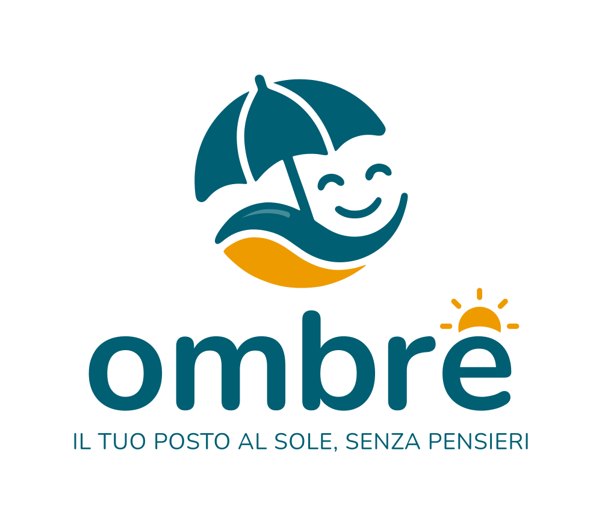

# Marchio «ombrè»

Regole d'uso del logo. **Il logo è del committente**: questi file lo riproducono in
vettoriale dalla sua scheda d'identità (`docs/grafica/identita-riferimento.jpg`, nel ramo
principale del progetto). Non è un disegno nostro e non va reinterpretato. Sostituisce
tutti i simboli usati prima nel progetto.

## In uso oggi: il logo arcobaleno (D64, 20/11/2026)

Dal tema arcobaleno **i file attivi sono quelli approvati dal committente**:

- `logo-arcobaleno-verticale.svg` — emblema, logotipo e motto, gradiente arcobaleno;
- `logo-arcobaleno-orizzontale.svg` — emblema e logotipo affiancati; è la fonte dei
  tracciati dei componenti `Logo`/`LogoLockup` di `packages/ui` (copiati tali e quali,
  non ridisegnati);
- `logo-arcobaleno-anteprima.png` — anteprima raster, da non usare come originale.

Il gradiente (id `arc` nei file del committente) è orizzontale, steso per forma sul
proprio riquadro: `#e63946` 0% → `#f77f00` 20% → `#fcbf49` 40% → `#2a9d8f` 60% →
`#0077b6` 80% → `#7b2cbf` 100%. Restano **arancio `#ee9b00`** il sole sulla «è» e
l'onda sotto l'ombrello; il riflesso sull'onda resta `#e0f2f1` al 30%. Sui fondi
scuri (piè di pagina) la scritta passa al bianco (`--su-scuro`) e **il simbolo resta
a colori**, come da tavola del direttore artistico (`docs/tema-arcobaleno.md`).

I file del marchio precedente (`logo-verticale.svg`, `logo-orizzontale.svg`,
`simbolo*.svg` e le altre versioni della tabella più sotto) **restano nel
repository** e non vanno cancellati: documentano il tema originale. Per
ripristinare il tema precedente esiste il tag git `ombre-tema-originale-20261120`
(più l'archivio in `/home/sysadmin/backup-ombre/`):

```sh
git checkout ombre-tema-originale-20261120 -- <file>   # per esempio:
git checkout ombre-tema-originale-20261120 -- packages/ui/src/index.tsx apps/web/app/icon.svg
```

Le sezioni che seguono descrivono la riproduzione del marchio originale e le regole
d'uso generali (aree di rispetto, misure minime), che valgono anche per la versione
arcobaleno.

> **Stato legale: non verificato.** La disponibilità del marchio «Ombrè» e dei domini è
> ancora una dipendenza aperta ([../stato.md](../stato.md)). Non è stata fatta alcuna
> ricerca di anteriorità, né sul nome né sul segno grafico.



## Com'è fatto

- **Emblema**, di forma circa circolare: un ombrellone inclinato visto di lato, a tre
  spicchi separati da stecche bianche, con il puntale in alto e il palo che scende verso
  destra; accanto al palo un viso sorridente fatto di tre tratti (due occhi chiusi ad
  arco e il sorriso); sotto, un'onda che risale a destra e chiude il cerchio, con un
  piccolo riflesso più chiaro sulla cresta; sotto l'onda una falce di sabbia color ambra.
- **Logotipo**: «ombrè» minuscolo in un carattere tondo e pieno. Al posto dell'accento
  grave sulla «e» c'è un piccolo **sole che sorge**: mezzo disco ambra con cinque raggi.
- **Motto**: «IL TUO POSTO AL SOLE, SENZA PENSIERI», in maiuscolo leggero e spaziato,
  sotto il logotipo.

## Come è stato riprodotto

- La scheda del committente è un'immagine JPEG (2816×1536 px) in cui l'emblema è largo
  circa 365 px. L'emblema è stato ricalcato dall'immagine ingrandita (maschere di colore
  e tracciamento automatico), poi ripulito: un solo tono pieno per colore, niente
  ombreggiature. Il riflesso sull'onda è ridisegnato a mano sopra l'originale.
- Confronto con l'originale, sovrapponendo il nostro disegno al ritaglio della scheda:
  nell'emblema differisce in modo netto lo 0,5% dei punti, tutti lungo i bordi (l'originale
  ha bordi sfumati). La sfumatura scura alla base dell'onda dell'originale è stata
  sostituita dal colore pieno.
- I colori sono quelli esatti della tavolozza, non quelli campionati dall'immagine.
- **Logotipo**: il carattere della scheda corrisponde a **Nunito Bold** (versione 3.602,
  licenza SIL Open Font License 1.1): sovrapposte, «o» e «m» coincidono. Per restare
  fedeli alla scheda le lettere sono posizionate una per una come nell'originale e l'asta
  della «b» è accorciata di 37 millesimi di corpo. La «e» della scheda è circa il 2% più
  larga della nostra. Il logotipo è **convertito in tracciati**: non serve avere il
  carattere installato.
- **Motto**: Nunito Regular in maiuscolo, spaziatura +0,024 em, anch'esso in tracciati.
- Il sole è costruito con forme geometriche (un disco tagliato da un arco, cinque raggi
  con le estremità tonde) sulle misure rilevate dalla scheda.

Il carattere dell'interfaccia resta Plus Jakarta Sans
([../progetto-grafico.md](../progetto-grafico.md)): Nunito si usa solo dentro il logo.

## Versioni

| File | Che cos'è | Quando si usa |
|---|---|---|
| `logo-verticale.svg` | Emblema, logotipo e motto uno sopra l'altro, **come nella scheda del committente** | Versione principale: copertine, presentazioni, materiali stampati, schermate d'apertura |
| `logo-verticale-su-scuro.svg` | Come sopra per fondi scuri, fondo trasparente | Su Slate Abyss |
| `logo-orizzontale.svg` | Emblema a sinistra e logotipo a destra, senza motto | Intestazioni del sito, firme, spazi bassi e larghi |
| `logo-su-scuro.svg` | Come sopra per fondi scuri, fondo trasparente | Piè di pagina e superfici Slate Abyss |
| `simbolo.svg` | Il solo emblema a colori | Dove il nome è già scritto accanto, avatar, spazi quadrati |
| `simbolo-su-scuro.svg` | Emblema per fondi scuri, fondo trasparente | Su Slate Abyss |
| `simbolo-monocromatico.svg` | Emblema in un solo colore, senza riflesso | Stampa a un inchiostro, timbri, incisioni. Colori ammessi: Deep Ocean Teal, Slate Abyss, bianco su fondo scuro |
| `../../apps/web/app/icon.svg` | Icona del sito: emblema su disco bianco | Solo come icona (scheda del browser, segnalibri) |

Anteprime in PNG, da non usare come originali: `simbolo-16.png`, `simbolo-32.png`,
`simbolo-192.png`, `simbolo-512.png`, `logo-orizzontale.png`, `logo-verticale.png` (fondo
trasparente), `logo-su-scuro.png` e `logo-verticale-su-scuro.png` (su Slate Abyss).

Che cosa viene dalla scheda e che cosa no:

- Dalla scheda: emblema, logotipo con il sole, motto e la loro disposizione verticale.
- Derivate da noi con gli stessi elementi, **da far approvare al committente**: la
  disposizione orizzontale, le versioni per fondi scuri, la versione a un colore e
  l'icona semplificata.

I file «su scuro» hanno il fondo trasparente: aperti da soli su una pagina bianca quasi
non si vedono.

### Nel sito

`packages/ui` espone due componenti, entrambi con `tone="color"` (predefinito) o
`tone="onDark"`:

- `Logo`: il solo emblema, decorativo, per quando il nome è scritto accanto come testo.
- `LogoLockup`: emblema e logotipo in orizzontale come un'unica immagine; il nome
  accessibile si passa con `label` e viene dalla configurazione. Non contiene il motto.

Dal tema arcobaleno i tracciati sono quelli di `logo-arcobaleno-orizzontale.svg` e il
gradiente è definito dentro ogni istanza con un id univoco (`useId`), così più loghi
sulla stessa pagina non si rubano il riferimento. Con `tone="onDark"` cambia solo il
logotipo (bianco); l'emblema resta a colori su ogni fondo.

### Icona e misure piccole

Dal tema arcobaleno l'icona (`apps/web/app/icon.svg`) è un **ombrellone a sei spicchi
piatti** nei colori pieni della palette (`#e63946`, `#f77f00`, `#fcbf49`, `#2a9d8f`,
`#0077b6`, `#7b2cbf`) con l'onda `#ee9b00`, su disco bianco perché si legga anche
sulle schede scure del browser. Niente gradiente e niente viso: a 16 px si
impasterebbero; a quella misura restano il ventaglio dei sei colori e l'onda.
(L'icona precedente — emblema teal semplificato — si ripristina col tag, vedi sopra.)

## Colori

| Colore | Valore | Ruolo nel logo |
|---|---|---|
| Deep Ocean Teal | `#005F73` | Ombrellone, viso, onda, logotipo e motto su fondi chiari |
| Sand Amber | `#EE9B00` | Sabbia dell'emblema e sole sul logotipo |
| Ivory Sand | `#F8F9FA` | Al posto del teal sui fondi scuri |
| Seafoam Tint | `#E0F2F1` | Riflesso sull'onda (al 30% sul teal; pieno nelle versioni per fondi scuri) |
| Slate Abyss | `#1D3557` | Fondo scuro; colore ammesso per la versione a un colore |

Contrasti (WCAG), dal progetto grafico:

| Coppia | Rapporto | Che cosa significa per il logo |
|---|---|---|
| Oceano su Avorio | 6,91:1 | Emblema, logotipo e motto ben leggibili |
| Oceano su Spuma | 6,29:1 | Idem |
| Oceano su bianco | 7,28:1 | Emblema sul disco bianco dell'icona |
| Avorio su Abisso | 11,72:1 | Versioni per fondi scuri |
| Ambra su Abisso | 5,49:1 | Sabbia e sole staccano bene sul fondo scuro |
| Ambra su Avorio | 2,14:1 | **Basso.** Sabbia e sole su fondo chiaro sono decorazione |
| Ambra su bianco | 2,25:1 | **Basso.** Idem |

Calcolato qui con la stessa formula: Oceano su Abisso 1,70:1.

Conseguenze pratiche:

- Il nome è sempre scritto in teal (o in avorio sui fondi scuri), mai in ambra. Il sole
  ambra sostituisce l'accento solo come segno grafico: dove il nome deve essere letto da
  tutti, anche dai lettori di schermo, è scritto come testo, «ombrè», con il suo accento.
- La versione a colori non va su Slate Abyss né su Deep Ocean Teal: lì si usa la versione
  per fondi scuri.
- Il motto è sottile: sotto le misure minime si toglie, non si rimpicciolisce.

## Area di rispetto

- **Logo verticale e orizzontale**: attorno al logo resta libero uno spazio pari
  all'altezza della «o» del logotipo. I file hanno già questo margine: basta non
  ritagliarli.
- **Emblema da solo**: spazio libero pari a un quarto del suo diametro su ogni lato.

Dentro l'area di rispetto non entrano testi, bordi, altre immagini o il margine del
foglio.

## Dimensioni minime

| Versione | A schermo | In stampa |
|---|---|---|
| Emblema | 24 px di lato perché il viso si legga; fino a 16 px solo come icona | 8 mm |
| Logo orizzontale | 28 px di altezza (circa 94 px di larghezza) | 10 mm di altezza |
| Logo verticale con motto | 200 px di larghezza (il motto resta alto circa 7 px) | 40 mm di larghezza |

Proporzioni fisse, da non ricomporre a mano:

- orizzontale: l'altezza della «o» è il 38% dell'altezza dell'emblema; fra emblema e
  logotipo c'è uno spazio pari al 42% dell'altezza della «o»;
- verticale: emblema, logotipo e motto sono centrati e alle distanze della scheda del
  committente.

## Cosa non fare

- Non ridisegnare, semplificare o «migliorare» l'emblema: si usano questi file.
- Non cambiare i colori e non aggiungere sfumature, ombre, contorni o effetti.
- Non ruotare, specchiare o deformare; non separare ombrellone, viso, onda e sabbia.
- Non riscrivere il logotipo con un altro carattere, non scriverlo con l'iniziale
  maiuscola e non sostituire il sole con un accento o con altro.
- Non cambiare proporzioni e distanze fra emblema, logotipo e motto.
- Non usare il motto da solo come se fosse il logo, e non usarlo sotto le misure minime.
- Non appoggiare il logo su fotografie o fondi mossi senza una superficie piena sotto, e
  non usare la versione a colori su fondi scuri.
- Non usare più i simboli precedenti (l'ombrellone di profilo sull'onda a zigzag e
  l'ombrellone visto dall'alto con la falce).

## Limiti onesti

- Marchio e domini non sono verificati (vedi in alto).
- L'originale ricevuto è un'immagine a bassa risoluzione, non un file vettoriale: i
  dettagli più piccoli (forma esatta del riflesso, raggio degli angoli, spessore dei
  tratti del viso) sono ricostruiti con uno scarto di circa un punto dell'immagine. Se il
  committente ha il file vettoriale originale, va usato quello.
- Il carattere è stato riconosciuto per sovrapposizione, non confermato dal committente.
- Le prove sono state fatte rasterizzando i file a 16, 32, 192 e 512 px su Ivory Sand e
  su Slate Abyss. Non ci sono prove di stampa né prove su schermi reali.
