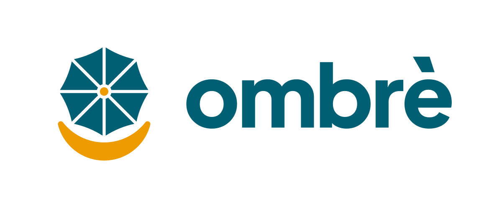

# Marchio «ombrè»

Regole d'uso del simbolo e del logo, disegnati l'11/11/2026 sul progetto grafico
«Solar & Fresh» ([../progetto-grafico.md](../progetto-grafico.md)). Sostituiscono il
vecchio simbolo (ombrellone di profilo su un'onda), che non va più usato.

> **Stato legale: non verificato.** La disponibilità del marchio «Ombrè» e dei domini è
> ancora una dipendenza aperta ([../stato.md](../stato.md)). Non è stata fatta alcuna
> ricerca di anteriorità, né sul nome né sul segno grafico: un ombrellone a otto spicchi
> visto dall'alto è un motivo diffuso e la somiglianza con marchi esistenti va controllata
> da un consulente prima di qualsiasi uso pubblico o deposito.

## Che cosa rappresenta

Il simbolo è fatto di due sole forme.

- **L'ombrellone visto dall'alto**: otto spicchi con il bordo appena incavato fra una
  stecca e l'altra, separati da raggi vuoti, e un puntale al centro. È il «posto» che si
  prenota, visto come sulla planimetria della spiaggia.
- **La falce sotto l'ombrellone**: è insieme un'onda che lo lambisce e un sorriso. Ha il
  colore del sole e riprende l'ombra che l'ombrellone lascia sulla sabbia.

Sole, mare e relax stanno in un segno solo; il nome, sempre minuscolo e con l'accento
grave, è «ombrè». Motto: «Il tuo posto al sole, senza pensieri.»

## Costruzione

Griglia quadrata di 240 unità, con 10 unità di margine interno.

| Elemento | Misure (unità della griglia) |
|---|---|
| Ombrellone | Centro (120; 95,8). Otto punte a 85,8 dal centro, una rivolta in alto; raggi vuoti larghi 6; bordo incavato del 2% |
| Puntale | Disco di raggio 8,2 dentro un anello vuoto di raggio 14,3 |
| Falce | Differenza fra due cerchi: quello esterno di raggio 92,4, quello interno di raggio 101,2 con il centro 44 più in alto. Spessore massimo 35; punte arrotondate con raggio 5,5 |
| Distanza fra ombrellone e falce | 13 |

I raggi orizzontale e verticale cadono sulla griglia dei pixel: per questo alle misure
piccole il segno resta nitido. Niente sfumature, niente contorni, tre tinte al massimo.

## Versioni

| File | Che cos'è | Quando si usa |
|---|---|---|
| `simbolo.svg` | Simbolo a colori: ombrellone Deep Ocean Teal, falce e puntale Sand Amber | Su fondi chiari: Ivory Sand, Seafoam Tint, bianco |
| `simbolo-su-scuro.svg` | Ombrellone Ivory Sand, falce e puntale Sand Amber, fondo trasparente | Su Slate Abyss e su Deep Ocean Teal |
| `simbolo-monocromatico.svg` | Tutto in un solo colore | Stampa a un inchiostro, timbri, incisioni, ricami; ogni volta che l'ambra non è disponibile o non stacca dal fondo. Colori ammessi: Deep Ocean Teal, Slate Abyss, bianco su fondo scuro |
| `logo-orizzontale.svg` | Simbolo e logotipo affiancati | Versione principale: intestazioni, documenti, presentazioni |
| `logo-su-scuro.svg` | Come sopra, logotipo Ivory Sand, fondo trasparente | Piè di pagina e superfici Slate Abyss |
| `../../apps/web/app/icon.svg` | Icona del sito: simbolo chiaro su tessera Deep Ocean Teal con angoli arrotondati | Solo come icona (scheda del browser, segnalibri). I raggi sono più larghi di un terzo per reggere a 16 px |

Anteprime in PNG, da non usare come originali: `simbolo-16.png`, `simbolo-32.png`,
`simbolo-192.png`, `simbolo-512.png` (fondo trasparente), `logo-orizzontale.png` (fondo
trasparente) e `logo-su-scuro.png` (su Slate Abyss).

I due file «su scuro» hanno il fondo trasparente: aperti da soli su una pagina bianca
il logotipo non si vede.

### Nel sito

Il componente `Logo` di `packages/ui` disegna il solo simbolo, con `tone="color"`
(predefinito) o `tone="onDark"`. È decorativo: il nome è sempre scritto accanto come
testo, preso dalla configurazione, e non è mai dentro il componente. Le illustrazioni
`CoastScene` e `BeachScene` riprendono lo stesso ombrellone visto dall'alto.

## Logotipo

- Carattere: Plus Jakarta Sans ExtraBold (peso 800), versione 2.071, spaziatura fra le
  lettere −0,03 em: la stessa del nome nell'intestazione del sito.
- Nei file originali il logotipo è **convertito in tracciati**: non serve avere il
  carattere installato e il risultato è identico ovunque. Plus Jakarta Sans è distribuito
  con licenza SIL Open Font License 1.1, che consente questo uso.
- Proporzioni fisse: l'altezza della «o» è il 38% dell'altezza del riquadro del simbolo;
  la fascia delle minuscole è centrata sul riquadro; fra simbolo e logotipo c'è uno
  spazio pari al 18% del riquadro. Simbolo e logotipo non si ricompongono a mano: si usa
  il file.

## Colori

| Colore | Valore | Ruolo nel marchio |
|---|---|---|
| Deep Ocean Teal | `#005F73` | Ombrellone e logotipo su fondi chiari; tessera dell'icona |
| Sand Amber | `#EE9B00` | Falce e puntale: è un accento, mai il colore del logotipo |
| Ivory Sand | `#F8F9FA` | Ombrellone e logotipo su fondi scuri |
| Slate Abyss | `#1D3557` | Fondo scuro; colore ammesso per la versione a un colore |
| Seafoam Tint | `#E0F2F1` | Solo come fondo |

Contrasti (WCAG), dal progetto grafico:

| Coppia | Rapporto | Che cosa significa per il marchio |
|---|---|---|
| Oceano e Avorio | 6,91:1 | Ombrellone e logotipo ben leggibili su fondo chiaro; ombrellone chiaro sulla tessera dell'icona |
| Oceano su Spuma | 6,29:1 | Idem |
| Bianco su Oceano | 7,28:1 | Versione a un colore, bianca, su Deep Ocean Teal |
| Abisso e Avorio | 11,72:1 | Ombrellone e logotipo chiari sul fondo scuro |
| Abisso e Ambra | 5,49:1 | La falce stacca bene sul fondo scuro |
| Ambra su Avorio | 2,14:1 | **Basso.** La falce su fondo chiaro è decorazione |
| Bianco e Ambra | 2,25:1 | **Basso.** Mai il simbolo chiaro su fondo ambra |

Calcolati qui con la stessa formula, perché il progetto grafico non li riporta: Ambra su
Oceano 3,23:1 (la falce nell'icona), Ambra su Spuma 1,95:1, Oceano su Abisso 1,70:1.

Conseguenze pratiche:

- Su fondi chiari la falce ambra ha poco contrasto. Va bene perché il simbolo è
  decorativo e il nome è sempre scritto accanto; quando il simbolo deve reggersi da solo
  o servire a persone con vista ridotta si usa la versione a un colore.
- Il logotipo non è mai ambra.
- Il simbolo a colori non va su Deep Ocean Teal né su Slate Abyss (1,70:1 fra i due):
  lì si usa la versione per fondi scuri.

## Area di rispetto

- **Logo orizzontale**: attorno al logo resta libero uno spazio pari all'altezza della
  «o» del logotipo. I file `logo-orizzontale.svg` e `logo-su-scuro.svg` hanno già questo
  margine: basta non ritagliarli.
- **Simbolo da solo**: spazio libero pari a un quarto della sua altezza su ogni lato.

Dentro l'area di rispetto non entrano testi, bordi, altre immagini o il margine del
foglio.

## Dimensioni minime

| Versione | A schermo | In stampa |
|---|---|---|
| Simbolo | 16 px di lato; sotto i 24 px i raggi si attenuano e restano ombrellone e falce | 6 mm |
| Icona del sito | 16 px | — |
| Logo orizzontale | 24 px di altezza del simbolo (circa 80 px di larghezza) | 10 mm di altezza del simbolo |

Sotto queste misure si usa il solo simbolo, non una versione rimpicciolita del logo.

## Cosa non fare

- Non cambiare i colori e non aggiungere sfumature, ombre, contorni o effetti.
- Non ruotare, inclinare, specchiare o deformare il simbolo; non staccare la falce
  dall'ombrellone e non usarne una senza l'altro.
- Non riscrivere il logotipo con un altro carattere o un altro peso, non scriverlo con
  l'iniziale maiuscola e non togliere l'accento: è «ombrè».
- Non cambiare proporzioni e distanza fra simbolo e logotipo, e non mettere il simbolo a
  destra o sopra il nome senza una versione disegnata apposta.
- Non appoggiare il logo su fotografie o fondi mossi senza una superficie piena sotto, e
  non usare la versione a colori su fondi scuri.
- Non usare il simbolo come unico portatore di un'informazione (uno stato, un avviso): è
  un segno di identità.
- Non usare più il vecchio simbolo con l'ombrellone di profilo.

## Limiti onesti

- Marchio e domini non sono verificati (vedi in alto).
- Le prove sono state fatte rasterizzando i file a 16, 32, 192 e 512 px su Ivory Sand e
  su Slate Abyss. Non ci sono prove di stampa né prove su schermi reali, e non esistono
  ancora versioni verticale, per app o per social.
